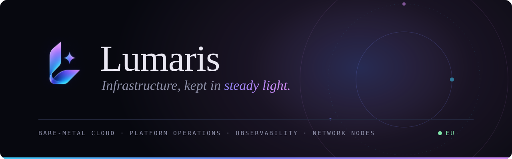
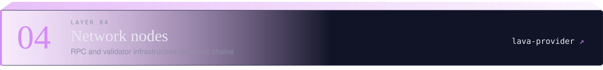
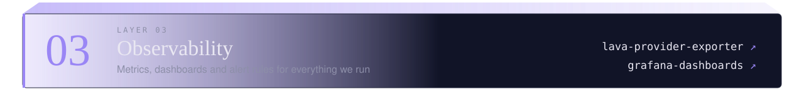
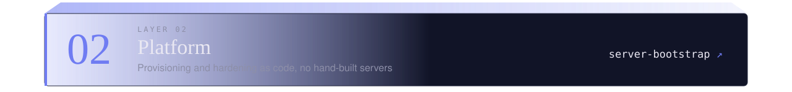
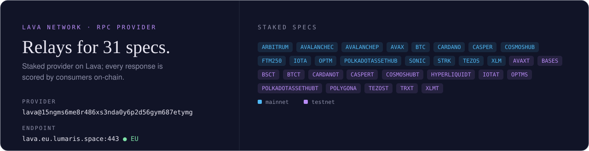

  

  <a href="https://lumaris.space"><b>lumaris.space</b></a> &nbsp;·&nbsp;
  <a href="mailto:lumarispro@gmail.com">lumarispro@gmail.com</a> &nbsp;·&nbsp;
  <a href="https://discord.com/users/1035236848882159666">Discord</a>

Lumaris designs and operates the layer underneath your product: bare-metal cloud, platform automation and observability, run by engineers who treat uptime as a craft. Our own fleet of dedicated servers runs in European data centres.

## The stack

We think about infrastructure as layers, each one resting on the one below. Every layer has a repository: the tooling we use to run it ourselves, published as it is.

| Layer | Repository | What's inside |
|:-:|---|---|
| `04` | [lava-provider](https://github.com/lumarispro/lava-provider) | Install, service unit, TLS proxy and status scripts for our Lava RPC provider |
| `03` | [lava-provider-exporter](https://github.com/lumarispro/lava-provider-exporter) | Prometheus exporter for a provider's on-chain state: stake, delegations, jails, per spec |
| `03` | [grafana-dashboards](https://github.com/lumarispro/grafana-dashboards) | Dashboards and alert rules for hosts and the Lava provider |
| `02` | [server-bootstrap](https://github.com/lumarispro/server-bootstrap) | Ansible roles that turn a fresh bare-metal host into a hardened, monitored node |
| `01` | [lumaris.space](https://github.com/lumarispro/lumaris.space) | Source of our website |

## On public chains

Blockchain nodes are demanding infrastructure: they never stop syncing, and their performance is measured in public. We run them with the same hardware, automation and monitoring as everything else.

## How we work

1. **Design for failure.** Redundancy where it matters, simplicity everywhere else.
2. **Automate the routine.** Provisioning, patching and recovery are code.
3. **Measure everything.** If it isn't observed, it isn't operated.

© 2026 Lumaris · Europe

